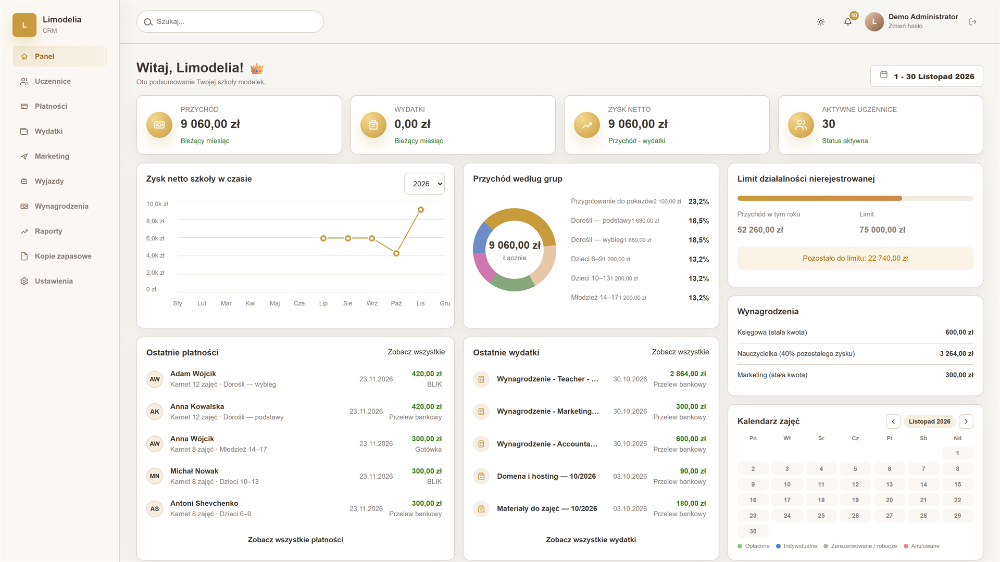
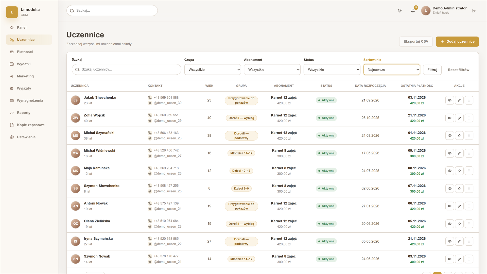
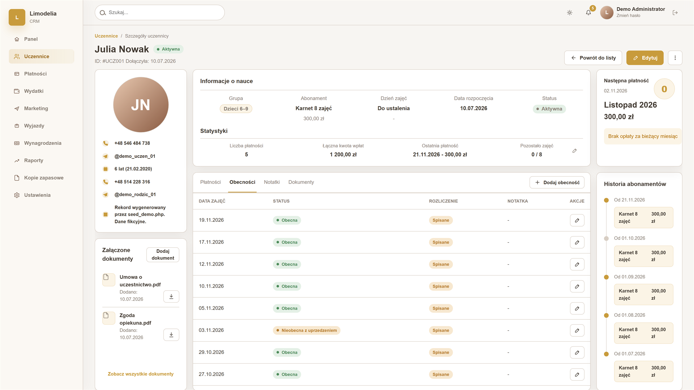
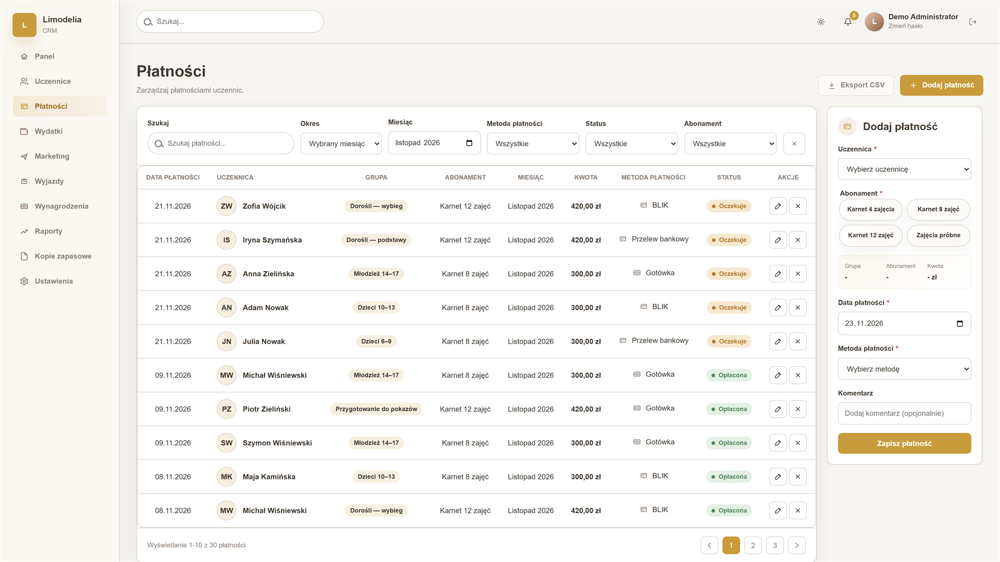
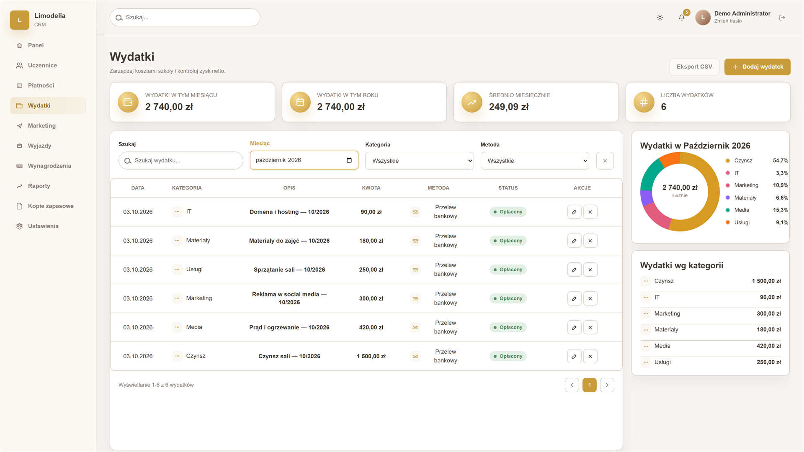
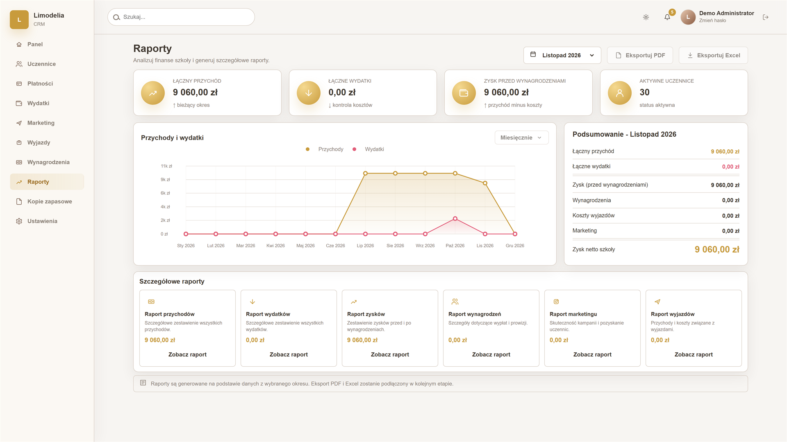

# Limodelia — CRM for a modelling school

An internal CRM that a modelling school uses daily to run students, groups,
attendance, payments, expenses and teacher pay. Built end to end in plain
PHP 8.2 with PDO and MySQL — no framework — and in daily production use.

> **Demo data only.** Every person, phone number and amount in this repository
> is fictional and generated by `database/seed_demo.php`. No real student,
> guardian or client data is published here, and no production database dump is
> included. `database/database.sql` contains structure only.

## What it does

- **Students and groups** — enrolment, group assignment, student and guardian
  contacts (phone and Telegram), statuses (lead / active / paused / inactive /
  archived).
- **Subscriptions** — lesson packages with price and billing period, per-student
  subscription history and used/remaining lesson balance.
- **Attendance** — one record per student per lesson date: present, absent with
  notice, absent without notice, cancelled by the school, and whether the lesson
  counts against the package.
- **Money** — student payments with period coverage and printable receipts,
  expense categories and printable expense receipts.
- **Salaries** — salary rules (fixed amount, per new student, percentage of net
  profit, remaining profit) and payouts per period with approval and payment
  dates; a paid payout records the linked salary expense.
- **Trips and events** — trips, capacity, price and internal cost, participants,
  Cloudinary-backed photo galleries.
- **Marketing** — campaigns with source, budget, leads and new-student counts.
- **Reporting** — six report views: financial summary, payments, expenses,
  salaries, trips and students. Marketing spend is shown inside the financial
  summary, not as a separate report.
- **Operations** — settings, in-app notifications, database backups.
- **Telegram** — a bot teachers use to mark attendance and to register students.

## Screenshots

Taken against the seeded demo database (`limodelia_demo`), never production.
Every name, phone number and amount below is fictional.

**Dashboard** — current-month KPIs, revenue split by group, recent payments and
expenses, lesson calendar.



**Students** — list with filters, group, subscription and last payment per
student.



**Student profile, attendance tab** — one record per lesson date with status and
whether the lesson counts against the subscription.



**Payments** — payment log with method, covered period and status, plus the
inline "add payment" form.



**Expenses** — expense log with categories, payment methods and a per-category
breakdown.



**Reports** — revenue and expenses over time, profit before salaries, and the
per-topic report cards.



## Stack

| Layer | Choice |
|---|---|
| Language | PHP 8.2, `declare(strict_types=1)` |
| Database | MySQL 8, InnoDB, utf8mb4, PDO prepared statements, foreign keys and CHECK constraints |
| Frontend | Server-rendered PHP templates, vanilla JavaScript, CSS |
| Runtime | Apache on XAMPP |
| Integrations | Telegram Bot API, Cloudinary |

No framework and no Composer by design: the goal was to own the request
lifecycle, the SQL and the data model rather than hide them behind an ORM.

## Data model

24 tables in `database/database.sql`:

- **people** — `users`, `roles`, `user_roles`, `students`
- **structure** — `student_groups`, `subscriptions`, `student_subscriptions`
- **attendance** — `attendance_records`
- **money** — `payment_methods`, `payments`, `expense_categories`, `expenses`,
  `salary_rules`, `salary_payouts`
- **events** — `trips`, `trip_participants`, `trip_photos`,
  `marketing_campaigns`
- **operations** — `settings`, `reports`, `system_logs`, `activity_logs`,
  `notifications`, `sessions`

Key constraints worth noting: attendance is unique per student and lesson date,
payment numbers are unique, expenses cannot be approved without an approver and
a timestamp, and salary payouts cannot be marked paid without a payment date.

## Roles

Defined in `database/seed.sql`. The roles are seeded and assigned to users, but
access control is not enforced yet — see *Known gaps*:

| Role | Scope |
|---|---|
| Owner | everything, including settings and finances |
| Administrator | students, groups, trips, payments, settings |
| Finance | payments, expenses, salaries, financial reports |
| Teacher | own groups, attendance, own salary summaries |
| Marketing | campaigns, leads, source tracking, marketing reports |
| Viewer | read-only dashboard and reports |

## Getting started

### Requirements

- PHP 8.2+ with `pdo_mysql`, `mbstring`, `curl`
- MySQL 8.0+
- Apache (XAMPP is what this was developed on)

### 1. Database

`database/database.sql` creates the `limodelia_crm` schema and its 24 tables.
It contains no rows.

```bash
mysql -u root -p < database/database.sql
mysql -u root -p limodelia_crm < database/seed.sql   # roles, settings, one admin placeholder
```

`seed.sql` inserts an administrator with a placeholder password hash. Set a real
hash before using that account:

```bash
php -r 'echo password_hash("your-password", PASSWORD_DEFAULT), PHP_EOL;'
```

### 2. Configuration

`config/db.php` reads the connection from environment variables, falling back to
`config/db.php` defaults, and optionally from an ini file:

| Variable | Purpose |
|---|---|
| `LIMODELIA_DB_HOST` | MySQL host, default `127.0.0.1` |
| `LIMODELIA_DB_NAME` | database name, default `limodelia_crm` |
| `LIMODELIA_DB_USER` | database user |
| `LIMODELIA_DB_PASSWORD` | database password |
| `LIMODELIA_ENV_FILE` | path to an ini file, default `/etc/limodelia/limodelia.env` |

Never commit `.env`. The repository's `.gitignore` already excludes it.

### 3. Run

Put the project under the Apache document root and open it in a browser, or use
the built-in server for a quick look:

```bash
php -S localhost:8080
```

### 4. Demo data (optional, separate database)

Never seed the real database. Create a throwaway copy of the schema:

```bash
mysql -u root -p -e "CREATE DATABASE limodelia_demo CHARACTER SET utf8mb4 COLLATE utf8mb4_unicode_ci"

# database.sql starts with CREATE DATABASE/USE limodelia_crm — strip those lines
# so the import lands in the demo database instead of the real one.
sed -E '/^CREATE DATABASE/d; /^  CHARACTER SET/d; /^  COLLATE/d; /^USE `/d' \
  database/database.sql > /tmp/limodelia_demo_schema.sql
mysql -u root -p limodelia_demo < /tmp/limodelia_demo_schema.sql
```

Then seed:

```bash
export DEMO_DSN="mysql:host=127.0.0.1;dbname=limodelia_demo;charset=utf8mb4"
export DEMO_USER=root
export DEMO_PASS=""

php database/seed_demo.php --list   # tables and columns found in the demo database
php database/seed_demo.php          # insert fictional data
```

The seeder refuses to run unless the database name contains `demo`, `dev`,
`test`, `seed` or `sandbox`, and it explicitly refuses `limodelia_crm`.

## Demo data

`database/seed_demo.php` creates, deterministically (`mt_srand`):

- 1 administrator, 3 teachers, 1 accountant, 1 marketing specialist, 4 roles
- 6 groups (children, teens, adults, runway, show preparation)
- 4 subscription packages and 3 payment methods
- 30 students with invented names, `+48 5xx` phone numbers and
  `demo_uczen_*` Telegram handles
- 4 months of payments plus the current month (some still pending)
- 8 weeks of attendance, two sessions per week per group
- 3 salary rules, 4 months of payouts with their linked salary expenses,
  6 expenses, 2 campaigns, 2 trips

Names, contacts and amounts are invented; `@example.com` is reserved for
documentation and cannot receive mail. Re-running requires `--reset --yes`,
otherwise unique keys such as e-mail and payment number collide.

## Known gaps (in progress)

- no access control yet: a signed-in user reaches every page, and the seeded
  roles are stored in the database without being checked on requests
- no CSV, PDF or Excel export: reports and lists are rendered as pages only
- no e-mail/SMTP integration
- salary rule types `per_lesson`, `bonus` and `deduction` exist in the schema but
  are not priced yet: only fixed, per new student, percentage of net profit and
  remaining profit are calculated
- no automated test suite yet — module checklists are manual
- no migration tool: schema changes are applied by hand and reviewed
- no CI pipeline

These are listed on purpose: they are the next things I am fixing.

## Contact

Artem Vitiaz — Bydgoszcz, Poland
[github.com/ShiBro360](https://github.com/ShiBro360) · shibro36@gmail.com
